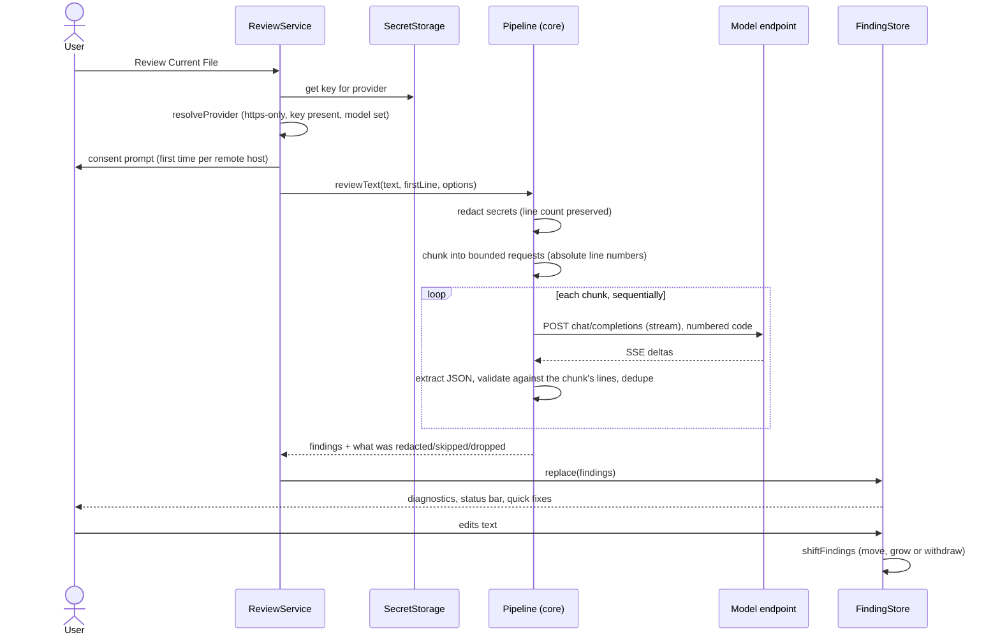

# Architecture

## Goals and non-goals

**Goals.** Review the code in front of the user with the model of the user's choice, show the result where developers already look (editor squiggles, Problems panel), and keep the user in control of what leaves their machine.

**Non-goals.** Repository-wide analysis, auto-applying patches, hosting a backend, or locking the user to one vendor. There is no server component: the extension talks directly from the user's machine to the endpoint they configured.

## Layers

```mermaid
flowchart TB
    subgraph vscode["src/vscode — adapter (imports the VS Code API)"]
        EXT[extension.ts<br/>commands, wiring]
        SVC[ReviewService<br/>settings, consent, progress, errors]
        STORE[FindingStore<br/>diagnostics, edit tracking, quick fixes]
        CHAT[chat.ts<br/>@reviewer]
        CONT[continue.ts<br/>optional context provider]
        KEYS[KeyStore<br/>SecretStorage]
    end
    subgraph core["src/core — pure TypeScript (no vscode import, lint-enforced)"]
        REV[review.ts<br/>pipeline]
        RED[redact.ts]
        CHK[chunk.ts]
        PRM[prompt.ts]
        PAR[parse.ts<br/>extract + validate]
        SHF[shift.ts<br/>edit tracking]
        PRS[present.ts<br/>ranges, markdown]
        PRV[providers/<br/>openai · anthropic]
        HTTP[http.ts<br/>retry, timeout, idle, cancel]
        SSE[sse.ts]
    end
    EXT --> SVC --> REV
    SVC --> KEYS
    SVC --> STORE
    CHAT --> REV
    CONT --> STORE
    STORE --> SHF
    STORE --> PRS
    REV --> RED --> CHK --> PRM --> PRV --> HTTP --> SSE
    REV --> PAR
```

The boundary is a lint rule (`no-restricted-imports` on `vscode` inside `src/core`), not a convention. Everything that can be wrong in a subtle way, such as protocol parsing, retries, redaction, line arithmetic, and validation of model output, lives in the pure core and is covered by unit tests against a real local HTTP server. The adapter contains almost no logic and is covered by integration tests in a real extension host.

## One review, end to end



## Key mechanisms

**Line numbers are the contract.** Models are unreliable at counting lines, so the prompt shows each line with an absolute gutter number (`  12 | code`) and the model cites those numbers. Selections and chunks keep absolute numbering, so findings never need remapping. Redaction preserves the line count for the same reason: a multi-line private key becomes the same number of lines.

**Validation, not trust.** The model's JSON is untrusted input. `parseFindings` accepts bare JSON, fenced JSON, or JSON embedded in prose (string-aware brace matching), then validates each entry: integer line inside the chunk, non-empty message, known severity and category (aliases mapped, unknown defaulting to `info` / `maintainability`), length caps, control characters stripped, duplicates removed. An entry that fails is _dropped and counted_, never repaired onto a nearby line. The count is shown to the user.

**Edits.** `shiftFindings` takes a VS Code content change (0-based line and column) and returns the findings that remain: unchanged above the edit, shifted below it, grown if a whole-line insertion falls inside a multi-line finding, withdrawn when the edit overlaps them. A range ending at column 0 of a later line is treated as not touching that line. When one change event carries several edits, they are applied lowest-first so that each edit's coordinates stay valid.

**Networking.** `postJson` retries 429, 5xx, network errors and header timeouts with exponential backoff, honouring `Retry-After` (seconds or HTTP-date, capped at 30 s) and never retrying 4xx. `readBody` wraps the stream with an idle timeout and cancellation. A hung connection therefore fails with a clear message instead of leaving a spinner. Error text from the provider is truncated and passed through the redactor, because providers sometimes echo part of the key back.

**Concurrency.** Chunks are sent sequentially: it keeps rate-limit behaviour predictable and cancellation immediate. A second review of the same file aborts the first (per-URI `AbortController`).

**Partial failure.** If some chunks fail and others succeed, the successful findings are kept and the failures are reported. Authentication and configuration errors abort at once, since every other chunk would fail identically. If all chunks fail the error is thrown.

## Failure modes

| Failure                                       | Behaviour                                                                                                                                                                                                                                          |
| --------------------------------------------- | -------------------------------------------------------------------------------------------------------------------------------------------------------------------------------------------------------------------------------------------------- |
| No key / bad URL / `http://` to a remote host | Refused before any request, with an action button (Set API Key / Open Settings)                                                                                                                                                                    |
| 401 / 403                                     | `auth` error, no retries, action button                                                                                                                                                                                                            |
| 429 / 5xx / network                           | Retried up to 2 times with backoff, then reported                                                                                                                                                                                                  |
| Provider silent                               | Timeout after `requestTimeoutSeconds`, retried once more per policy, then reported                                                                                                                                                                 |
| User cancels                                  | Request aborted, socket closed, no error toast                                                                                                                                                                                                     |
| Model returns prose instead of JSON           | Chunk counts as failed (`protocol`); other chunks still count                                                                                                                                                                                      |
| Model cites a line outside the chunk          | Finding dropped and counted                                                                                                                                                                                                                        |
| Model streams forever                         | Aborted at 200,000 characters                                                                                                                                                                                                                      |
| Document edited during a review               | Edits made while the request is in flight are recorded and replayed onto the result before it is shown (a review of a selection that was itself edited is discarded and the user is told); a newer review of the same file supersedes an older one |
| Continue's API changes                        | Registration wrapped in `try`/`catch`; reviews are unaffected                                                                                                                                                                                      |

## Limits

- One file at a time, no cross-file context, no overlap between chunks.
- At most 6 chunks per review (default 60,000 characters each), then the remainder is skipped and reported.
- Redaction is regex-based. It will not find a secret with no recognisable shape.
- The Continue integration depends on Continue exposing `registerCustomContextProvider`; it is written against that API but was not exercised against a live Continue install.
