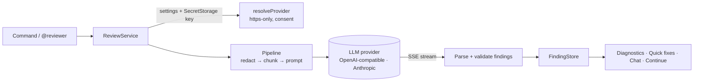

# AI Code Reviewer

[](https://github.com/dipesh9765/AI-Code-Reviewer/actions/workflows/ci.yml)


Inline AI code review for VS Code. Run a review and the findings appear as squiggles and entries in the **Problems** panel, on the right lines, with a suggested fix and a quick-fix menu. **Bring your own model**: OpenAI, Anthropic, a local Ollama, or any OpenAI-compatible server. Your key lives in the OS keychain, secrets in your code are redacted before anything is sent, and nothing leaves your machine until you say so.

This repository is the merge of two earlier experiments: a JavaScript chat participant hard-wired to OpenAI's Assistants API (`AI-Code-Reviewer`) and a scaffold for a Continue context provider (`Continue-ai-extension`). See [PROGRESS.md](PROGRESS.md) for what was wrong with them and what replaced them.



## Features

- **Inline diagnostics.** Findings are validated against the lines that were actually sent; anything pointing at the wrong place is dropped, never "repaired" onto the wrong line.
- **Findings follow your edits.** Insert a line above a finding and it moves with its code; edit the flagged line and it is withdrawn, because the comment may no longer apply.
- **Provider-agnostic.** One small interface (`LlmProvider`). OpenAI, Anthropic, Ollama, LM Studio, vLLM, OpenRouter and Groq work out of the box. No vendor SDK is bundled: the whole extension is a single file of about 30 KB with **zero runtime dependencies**.
- **Private by default.** Keys are stored in VS Code SecretStorage (the OS keychain), never in settings. API keys, tokens and private keys in your code are replaced with `[REDACTED:...]` placeholders (line numbers preserved) before the request. The first request to a remote host asks for consent. Plain `http://` is refused for anything but localhost. Use Ollama and nothing leaves your computer.
- **Selection or whole file.** Large files are split into bounded requests (default 60,000 characters each, at most 6) instead of overflowing the model's context; what was skipped is reported.
- **Chat.** `@reviewer` in the chat view reviews the open file, or answers a question about it (`@reviewer why is this loop O(n²)?`).
- **Robust networking.** Streaming, exponential backoff with `Retry-After`, per-request timeouts, idle-stream detection and cancellation from the progress notification.
- **Optional Continue integration.** If the [Continue](https://continue.dev) extension is installed, the current file's findings are offered as an `@AI Review` context item.

## Quick start

1. Install the `.vsix` (see [Install](#install)) and reload VS Code.
2. Run **AI Code Reviewer: Select Provider and Model**, pick a provider, and paste your API key when asked. (For Ollama, no key is needed.)
3. Open a file and run **AI Code Reviewer: Review Current File** (or select code and run **Review Selection**, or right-click in the editor).
4. Findings appear in the editor and in the Problems panel. Press `Ctrl+.` on one for **Copy suggested fix** or **Dismiss this finding**.

### Providers

| Provider    | Default model      | Key      | Notes                                                                           |
| ----------- | ------------------ | -------- | ------------------------------------------------------------------------------- |
| `openai`    | `gpt-4o-mini`      | yes      | `https://api.openai.com/v1`                                                     |
| `anthropic` | `claude-haiku-5-5` | yes      | `https://api.anthropic.com`, Messages API                                       |
| `ollama`    | `qwen2.5-coder`    | no       | `http://localhost:11434/v1`, fully local                                        |
| `custom`    | (you choose)       | optional | any OpenAI-compatible `/chat/completions` endpoint via `aiCodeReviewer.baseUrl` |

Model names change quickly; set `aiCodeReviewer.model` to whatever your account offers.

## Settings

| Setting                                | Default            | Meaning                                                |
| -------------------------------------- | ------------------ | ------------------------------------------------------ |
| `aiCodeReviewer.provider`              | `openai`           | `openai`, `anthropic`, `ollama`, `custom`              |
| `aiCodeReviewer.model`                 | (provider default) | Model name                                             |
| `aiCodeReviewer.baseUrl`               | (provider default) | Override the endpoint; required for `custom`           |
| `aiCodeReviewer.minSeverity`           | `info`             | Hide findings below `info` / `warning` / `error`       |
| `aiCodeReviewer.redactSecrets`         | `true`             | Replace credentials with placeholders before sending   |
| `aiCodeReviewer.maxInputChars`         | `60000`            | Characters per request; larger files are chunked       |
| `aiCodeReviewer.requestTimeoutSeconds` | `90`               | Time to first byte and maximum silence while streaming |

In untrusted workspaces `provider` and `baseUrl` cannot be set by the workspace, so an opened repository cannot redirect your code to a server of its choosing.

## Commands

| Command                                | What it does                                                         |
| -------------------------------------- | -------------------------------------------------------------------- |
| Review Current File / Review Selection | Run a review (a newer review of the same file cancels the older one) |
| Clear Findings                         | Remove all findings                                                  |
| Select Provider and Model              | Pick provider and model, then store a key if needed                  |
| Set API Key / Delete Stored API Key    | Manage keys in the OS keychain                                       |

## Install

From a build of this repository:

```bash
npm ci
npm run package          # produces ai-code-reviewer-1.0.0.vsix
code --install-extension ai-code-reviewer-1.0.0.vsix
```

## Development

```bash
npm ci
npm run check            # typecheck + lint + format check + unit tests with a coverage gate
npm run test:integration # launches a real VS Code against a mock model server (needs a desktop or xvfb)
npm run watch            # rebuild on change; press F5 in VS Code to debug
```

The code is split on a hard boundary, enforced by a lint rule: `src/core` never imports `vscode`, so the entire review pipeline is unit-tested with plain Node and a local mock HTTP server. `src/vscode` is a thin adapter that the integration suite drives like a user would. Details are in [ARCHITECTURE.md](ARCHITECTURE.md).

## Testing

| Layer                                                                | What is covered                                                                                                                                                                                                                                                                                       |
| -------------------------------------------------------------------- | ----------------------------------------------------------------------------------------------------------------------------------------------------------------------------------------------------------------------------------------------------------------------------------------------------- |
| Unit (Vitest, 137 tests, 100% line coverage of `src/core`, gate 90%) | SSE parser edge cases (split frames, CRLF, split UTF-8), retry/timeout/cancel, both provider dialects against a real local HTTP server, redaction (each credential kind, line-count preservation, false positives), chunking, tolerant JSON extraction, finding validation, edit shifting, URL safety |
| Integration (real VS Code extension host, 7 tests)                   | Activation, end-to-end review to diagnostics, findings shifting as text is edited, quick fixes, selection offsets, proof that a secret never appears in the request body, edits made while a review runs, failure handling                                                                            |

## Design decisions

| ADR                                                          | Decision                                                                    |
| ------------------------------------------------------------ | --------------------------------------------------------------------------- |
| [0001](docs/adr/0001-merge-into-one-typescript-extension.md) | Merge the two repositories into one TypeScript extension                    |
| [0002](docs/adr/0002-fetch-not-vendor-sdks.md)               | Talk to providers with `fetch` and SSE, not vendor SDKs                     |
| [0003](docs/adr/0003-pure-core-thin-adapter.md)              | A pure core behind a thin VS Code adapter                                   |
| [0004](docs/adr/0004-never-trust-model-output.md)            | Treat model output as untrusted input and validate it against what was sent |
| [0005](docs/adr/0005-privacy-redaction-consent.md)           | Privacy: keychain, redaction, consent, https-only                           |

## Limitations and roadmap

Reviews are file-local: the model sees one file (or chunk), not your repository, so it cannot catch cross-file contract violations. Chunks are independent, with no overlap, so an issue that spans a chunk boundary can be missed. Quality depends entirely on the model you choose; the findings are suggestions, not proofs. Redaction is pattern-based and catches common credential shapes, not every secret. Not yet done: review-on-save, applying suggested fixes as edits, streaming partial findings, repository-level context, and publishing to the Marketplace.

## License

MIT, see [LICENSE](LICENSE).
